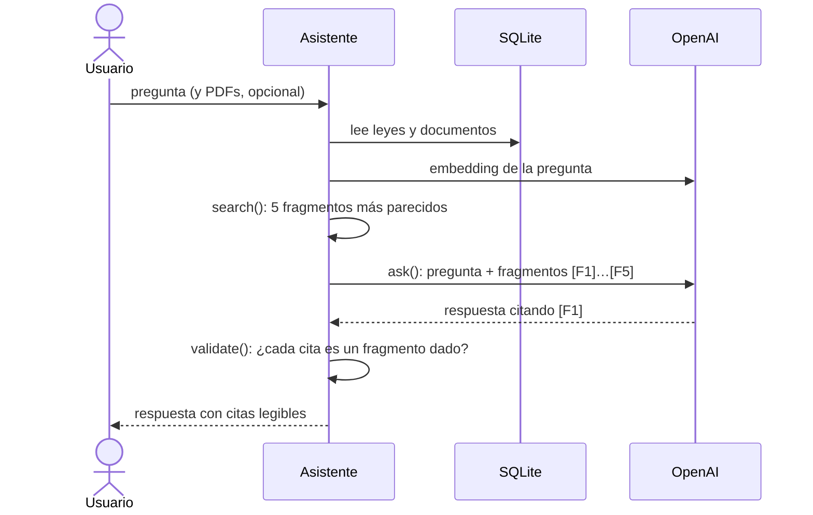

# Asistente de derechos laborales (México)

Un asistente que responde preguntas de empleados sobre sus derechos laborales. Busca en la
Ley Federal del Trabajo (LFT), en el artículo 123 de la Constitución (CPEUM) y en los PDFs
propios que suba el usuario (reglamento interno, contrato, lineamientos). Cada respuesta cita
de dónde viene cada dato y avisa cuando la respuesta no está en los documentos.

Se usa desde un notebook. Cada pregunta deja una traza en Langfuse con sus tres pasos:
búsqueda, llamada al modelo y validación.

## Explicación corta

**Antes, una sola vez:** `index.py` lee los PDFs de las leyes, los parte por artículo (los muy
largos, en pedazos de hasta 400 palabras) y guarda cada pedazo con su embedding en
`data/laws.sqlite`. La base ya viene cargada en el repo (1444 pedazos).

**Cada pregunta** sigue este camino:



Cada función vive en su módulo: `search()` en `retrieve.py`, `ask()` en `generate.py` y
`validate()` en `validate.py`. `assistant.py` las une.

En Langfuse, cada pregunta es una traza `question` con tres pasos: `search`, `LLM` y
`validation`.

**Evaluación:** un proceso aparte (`eval/run_eval.py`) mide si la búsqueda trae el artículo
correcto para 14 preguntas de prueba. Resultado: **9 de 11** aciertos en el top 5. Las otras 3
son preguntas sin respuesta, y el asistente avisó correctamente en las 3.

## Estructura

```
src/mx_labor_law_assistant/
  config.py      rutas, modelos y clientes de OpenAI y Langfuse
  ingest.py      PDF de ley → artículos → pedazos
  store.py       SQLite: guardar y leer pedazos con su embedding
  index.py       crea data/laws.sqlite (se corre una vez)
  retrieve.py    embeddings y búsqueda (top 5 por producto punto)
  generate.py    llamada al modelo con las instrucciones
  validate.py    revisa las citas de la respuesta
  user_docs.py   PDFs del usuario: leer por página y guardar
  assistant.py   une todo: answer(pregunta) y el comando de terminal
eval/
  questions.json preguntas de prueba con su artículo esperado
  run_eval.py    evaluación de la recuperación
  results/       reporte de la última corrida
data/
  laws/          PDFs oficiales y SOURCES.md con fechas
  examples/      documento propio de ejemplo y su fuente
  laws.sqlite    base ya cargada
notebook/demo.ipynb
```

## Cómo correrlo

### Variables de entorno

Crea un archivo `.env` en la raíz del repo (no se sube a git):

```
OPENAI_API_KEY=...
OPENAI_MODEL=...
OPENAI_EMBEDDING_MODEL=...
LANGFUSE_PUBLIC_KEY=...
LANGFUSE_SECRET_KEY=...
LANGFUSE_BASE_URL=...
```

Sin comillas en los valores: Docker las pasa tal cual.

### Con Docker (un solo comando)

```
docker build -t mx-labor-law-assistant .
docker run --rm -p 127.0.0.1:8888:8888 --env-file .env mx-labor-law-assistant
```

Abre http://localhost:8888/lab/tree/notebook/demo.ipynb. La base de leyes ya viene cargada en
la imagen.

### Local, con Poetry

```
poetry install
poetry run jupyter lab
```

Abre `notebook/demo.ipynb` con el kernel **Python 3** del proyecto.

### Ejemplo de uso desde el notebook

```python
from pathlib import Path

from src.mx_labor_law_assistant.assistant import answer
from src.mx_labor_law_assistant.user_docs import add_documents

add_documents([Path("data/examples/lineamientos_ccl_cdmx.pdf")])
# {'done': ['lineamientos_ccl_cdmx.pdf'], 'failed': []}

resp = answer("¿Cuántos días puede durar como máximo la conciliación antes de demandar?")
resp["answer"]      # respuesta con citas legibles
resp["sources"]     # fragmentos citados, con su texto
resp["validation"]  # citados, no citados y si las citas son válidas
```

`notebook/demo.ipynb` tiene cuatro ejemplos ya ejecutados: una pregunta sobre la ley, la carga
de un documento, una pregunta que mezcla ley y documento, y una pregunta sin respuesta.

### Desde la terminal

```
poetry run python -m src.mx_labor_law_assistant.assistant --docs ruta/al/archivo.pdf --question "¿Cuántos días puede durar como máximo la conciliación antes de demandar?"
```

`--question` es obligatorio. `--docs` es opcional y acepta uno o varios PDFs; lo que se carga
queda guardado en `data/user.sqlite` para las siguientes preguntas.

### Evaluación (un solo comando)

```
poetry run python -m eval.run_eval
```

Dentro de Docker:

```
docker run --rm --env-file .env mx-labor-law-assistant python -m eval.run_eval
```

El reporte queda en `eval/results/retrieval.json`.

## Fuentes y versiones

- **LFT**: última reforma DOF 14-05-2026.
- **CPEUM**: última reforma DOF 07-10-2026. Solo se usa el artículo 123.
- Descargadas el 2026-11-02 de https://www.diputados.gob.mx/LeyesBiblio/ (ver
`data/laws/SOURCES.md`).
- **Documento de ejemplo**: Lineamientos del procedimiento de conciliación prejudicial laboral
del Centro de Conciliación Laboral de la Ciudad de México, Gaceta Oficial de la CDMX,
22-02-2024 (ver `data/examples/SOURCES.md`).

## Resultados de la evaluación

La evaluación mide la **recuperación**: para cada pregunta, si alguno de los artículos esperados
está entre los 5 fragmentos que trae la búsqueda. No usa el modelo, así que es barata y
repetible. Busca 10 y guarda el puesto, para ver qué tan cerca quedó un fallo.

Las preguntas (`eval/questions.json`) están en lenguaje coloquial: 6 de la LFT, 3 de la
Constitución, 2 sobre el documento de ejemplo y 3 sin respuesta. Las de ley las redactó un
asistente de IA con búsqueda web, sin ver mis datos, para no inflar el resultado; después
verifiqué contra el texto oficial que los artículos esperados sí responden cada pregunta.

| Pregunta | Acierto | Puesto |
|---|---|---|
| lft-despido-indemnizacion | sí | 2 |
| lft-vacaciones | sí | 1 |
| lft-aguinaldo | sí | 1 |
| lft-prima-vacacional | sí | 1 |
| lft-embarazo-despido | sí | 1 |
| lft-descanso-semanal | sí | 5 |
| cpeum-salario-minimo | sí | 2 |
| cpeum-huelga | sí | 1 |
| cpeum-horas-extra | no | 7 |
| own-doc-duracion-conciliacion | no | 6 |
| own-doc-fecha-audiencia | sí | 2 |

**9 de 11.** Lo que explica los resultados:

- **Los dos fallos quedan cerca** (puestos 6 y 7): la búsqueda sí encuentra el texto, pero
otros fragmentos parecidos le ganan. No moví los artículos esperados para que acertaran.
- `lft-descanso-semanal` **es frágil**: acierta justo en el puesto 5.
- **El documento compite con la ley**: al agregar el documento de ejemplo,
`lft-despido-indemnizacion` bajó del puesto 1 al 2.
- **La redacción importa**: la misma duda de la duración de la conciliación, preguntada con
otras palabras, sí trajo la página correcta en el top 5.
- **Límite**: en la base, la Constitución es solo el artículo 123, así que esas 3 preguntas
son fáciles.
- **Preguntas sin respuesta**: en las 3 el asistente dijo que los documentos no traen el dato
(monto del salario mínimo, trámite del SAT, semanas del IMSS) y no inventó cifras.

## Cómo se resolvió cada reto

### 1. Lenguaje coloquial

La búsqueda usa embeddings, no palabras exactas: «¿me pueden correr por estar embarazada?»
casi no comparte palabras con el art. 133 de la LFT, pero su significado queda cerca. Las
preguntas de prueba están escritas como hablaría un empleado, y 9 de 11 encuentran el artículo
correcto. Los fallos muestran el límite: cuando varios artículos hablan de lo mismo, el correcto
puede quedar fuera del top 5.

### 2. Preguntas sin respuesta

Dos capas:

1. **Instrucciones**: el modelo responde solo con los fragmentos dados y, si la respuesta no
   está, lo dice, no la inventa y no pone citas.
2. **Validación**: cada cita debe ser de un fragmento entregado; una cita inventada sale en
   `unknown` y la respuesta queda como `valid: False`.

En las 3 preguntas sin respuesta de la evaluación, el asistente avisó que el dato no estaba. A
veces cita artículos relacionados (por ejemplo el que define el salario mínimo) para explicar lo
que sí dicen; por eso el veredicto de «avisó que no está» se revisa leyendo la respuesta, no
contando citas.

### 3. Varias fuentes

Los documentos del usuario se guardan en otra base (`data/user.sqlite`, ignorada por git,
porque pueden tener datos privados). Al preguntar, se juntan con las leyes en una sola lista y
la búsqueda no distingue de dónde viene cada fragmento.

No prioricé una fuente sobre otra: las instrucciones piden decir qué dice cada una, y cada dato
lleva su cita. Ejemplo real: a «¿cuánto puede durar la conciliación?», el asistente respondió
que los lineamientos fijan 45 días naturales `(lineamientos_ccl_cdmx.pdf, p. 4)` y que la LFT
fija 15 días para la audiencia, no para todo el procedimiento `(LFT, art. 684-E)`.

**Cómo se cita.**

- Al principio el modelo escribía las citas a mano y las cambiaba: inventó un nombre para el
  documento («Lineamientos CCL CDMX») y mezcló la página con un artículo interno («p. 4, art. 9»).
- Mejorar el texto del prompt no bastó.
- Ahora cada fragmento llega con un id corto (`[F1]`…`[F5]`): el modelo solo escribe el id y
  el código pone la cita legible.
- Es la misma idea de los trabajos de atribución que citan con índices numéricos (ALCE, Gao et
  al., 2023).

### 4. Diagnóstico

Cada pregunta deja una traza en Langfuse con tres pasos separados, cada uno con su tiempo,
tokens y costo:

- `search` (con `EMB` dentro): qué fragmentos trajo y con qué puntaje.
- `LLM`: qué recibió el modelo y qué contestó.
- `validation`: qué fragmentos se citaron, cuáles no y si alguna cita es inventada.

Para saber qué falló: si los fragmentos correctos no están en `search`, falló la búsqueda; si
están pero la respuesta es mala, falló el modelo; si una cita mala pasó, falló la validación.

**Caso real: pregunta compuesta.** «Me despidieron sin causa, ¿qué indemnización me toca? ¿Y el
aguinaldo y la prima vacacional?».

- La respuesta dijo que no tenía la información de aguinaldo ni prima.
- Paso `LLM`: el modelo fue honesto con lo que recibió.
- Paso `search`: trajo los arts. 436, 79, 50, 251 y 157, y no el 48 (puesto 6), el 87
  (puesto 46) ni el 80 (puesto 140).
- Fue un fallo de **búsqueda**, no del modelo: un solo vector para cuatro temas.
- Mejora: partir la pregunta en sub-preguntas y buscar cada una.

**Otro caso: el validador explicó un fallo.** Una respuesta sobre la conciliación no mencionó
los lineamientos. En `validation`, `not_cited` y `cited` solo tenían fragmentos de la LFT: el
documento ni siquiera había llegado a la búsqueda, porque la base del usuario estaba vacía.

### 5. Faithfulness (fidelidad)

Hoy la validación es **estructural**: revisa que cada cita sea de un fragmento entregado. No
revisa que ese fragmento de verdad respalde la frase. Esa diferencia importa: un estudio reporta
que muchas citas correctas pueden ser racionalizadas después, sin que el modelo se haya basado en
ese documento (Wallat et al., 2024).

Propuesta para medirla:

1. Partir cada respuesta en afirmaciones (una por frase con cita).
2. Para cada afirmación, preguntar a un modelo juez si el fragmento citado la respalda (sí/no).
3. Fidelidad = afirmaciones respaldadas / afirmaciones totales, por respuesta y en promedio.

Un control barato antes del juez: pedir al modelo una cita textual breve por dato y comprobar en
código que esté dentro del fragmento citado.

### 6. Más allá de la fidelidad

Una respuesta puede ser fiel y no servir. Propuestas, con ejemplos que vi:

- **¿Contesta la pregunta?** Un juez que compare pregunta y respuesta. En la pregunta compuesta,
la respuesta fue fiel pero dejó sin contestar dos de los cuatro temas.
- **¿El fragmento es el correcto?** La evaluación de recuperación ya lo mide (9 de 11). Se puede
sumar el puesto promedio del artículo correcto.
- **Fragmentos que confunden.** El art. 199 de la LFT (otro régimen de vacaciones) aparece en el
top 5 de la pregunta de vacaciones. Medir cuántas respuestas mencionan un fragmento que no
aplica al caso.
- **Completitud.** Para preguntas con varios temas, contar cuántos temas quedaron respondidos.
- **Aviso correcto.** En preguntas sin respuesta, la proporción que avisa sin inventar; en
preguntas con respuesta, la proporción que dice «no está» por error.

## Supuestos

- La Constitución se reduce al artículo 123, que es el laboral.
- Los PDFs del usuario se parten por página, porque no tienen artículos. Una idea puede quedar
cortada entre dos páginas.
- Los PDFs del usuario deben tener texto; uno escaneado se reporta como fallido.
- Las notas de reforma («Artículo reformado DOF …») se quedan dentro del texto, porque le dan la
fecha al modelo.
- La evaluación de recuperación cuenta acierto si algún artículo esperado está en el top 5.
- El documento de ejemplo es un texto oficial publicado en la Gaceta de la CDMX; se incluye con
su fuente.

## Qué haría distinto con más tiempo

- Partir las preguntas compuestas en sub-preguntas antes de buscar.
- Probar otro tamaño de pedazo y otro `k`, y comparar versiones con la misma evaluación.
- Medir la fidelidad con el juez del reto 5.
- Salida estructurada (JSON con `enum` de ids) para que el formato de las citas sea imposible de
romper.
- OCR solo para las páginas sin texto de los PDFs del usuario.
- Unir citas repetidas cuando dos pedazos son del mismo artículo.
- Que el asistente funcione sin llaves de Langfuse (sin trazas) para quien solo quiera probarlo.

## Uso de asistentes de IA

Usé Claude Code como guía en las dos partes: para discutir decisiones, revisar mi código y
proponer la redacción de este README y de las celdas de texto del notebook, que revisé y
ajusté. El código lo escribí y lo corrí yo, paso por paso. También lo usé para tareas
puntuales: redactar las preguntas de prueba sin ver mis datos, buscar el documento de ejemplo y
revisar técnicas para que el modelo cite bien. Revisé y entiendo todo lo que se entrega.

## Parte 2: clasificación

El notebook está en [`classification/breast_cancer.ipynb`](classification/breast_cancer.ipynb),
con las explicaciones en celdas de texto.

- **Datos:** 569 tumores (212 malignos, 357 benignos) con 30 medidas, de `load_breast_cancer`.
- **Criterio:** dejar pasar un maligno es el error más grave, así que la métrica principal es el
  recall de la clase maligna; el AUC es la segunda.
- **Partición:** 60 % entrenamiento, 20 % validación, 20 % prueba, estratificada.
- **Modelos:** regresión logística, KNN y bosque aleatorio, comparados en validación.
- **Elegido:** regresión logística, sin falsos negativos en validación y sin overfitting (el
  bosque sí lo mostró: 1.000 en train contra 0.965 en validación).
- **Prueba:** accuracy 0.991, AUC 0.997; detectó 42 de 43 malignos.
